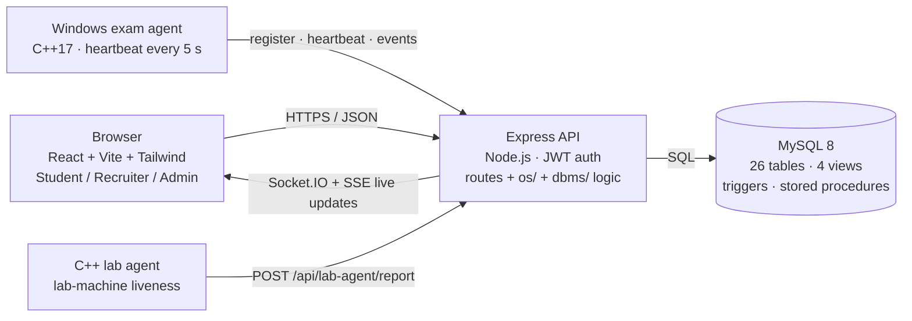
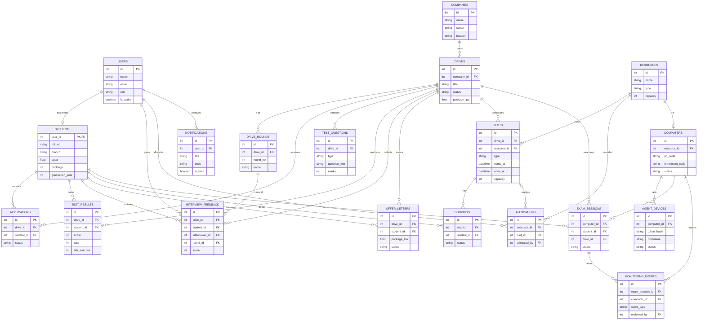

# CampusFlow

Placement, scheduled. A placement pipeline — drives, aptitude tests, shortlisting and interviews — where the system does the scheduling and students just show up. Built with real OS concepts (locks, critical sections, scheduling, Banker's algorithm) running on a real database.

Built by a 4-member team for a PBL evaluation (Operating Systems + DBMS).

## Features

### Student portal
- Find drives that match your profile (CGPA, branch, backlogs, graduation year)
- 1-click apply, with eligibility reasons if you don't qualify
- My Applications — Applied → Test → Result → Interview tracker
- In-app aptitude and coding test — timed, auto-submits, instantly graded
- Test venue and interview slot appear automatically; nothing to book
- Notifications for test schedules, results and interview invites
- My Schedule — all upcoming tests and interviews in one place
- My Journey — full timeline of an application, with offer answers and withdrawal

### Recruiter portal
- Add Drive wizard — drive details and eligibility, test questions, interview setup, review with a live count of eligible students
- Drive dashboard — pipeline tracker with funnel stats
- Schedule tests and publish results in one click — the system batches applicants into labs, shortlists by score and builds the interview timetable
- Applicants list with search, bulk shortlist/reject and per-student offers
- Inbox for notifications

### Admin — Control Center
- All drives with stage, progress and one-click next steps
- Full schedule of every test and interview session
- Resources — labs and interview rooms; the auto-scheduler plans against this inventory
- Live Monitor — watch bookings happen live, with a rush-hour test that proves seats can't be double-booked
- Exam Monitoring and Exam PCs — live exam feed, lab-PC allocation (First Fit / Best Fit), Windows monitoring agent for proctored exams
- Reports — placement progress per drive, company, branch and package
- Users — directory of all accounts; staff accounts are created here

### The pipeline engine
Recruiters configure; the system executes. Test sessions are batched into labs, every seat is assigned inside a serialized database critical section (`SELECT … FOR UPDATE`), tests are auto-graded, shortlists are score-based, and interviews are timetabled across panels and rooms. Students are notified at every step.

## System architecture



Full detail: [docs/ARCHITECTURE.md](docs/ARCHITECTURE.md).

## ER diagram



`lab_machines`, `manual_events`, `audit_log`, `lock_events`, `os_runs` and `demo_seats` are supporting tables — see [docs/archive/ER_DIAGRAM.md](docs/archive/ER_DIAGRAM.md).

## Run it locally

Full guide, including troubleshooting: [docs/03_INSTALLATION.md](docs/03_INSTALLATION.md)

```bash
# 1. Database (MySQL 8)
docker compose up -d

# 2. Backend → http://localhost:5000
cd server
cp .env.example .env        # first time only — set DB_PASSWORD to your MySQL password
npm install
npm run db:reset            # builds schema + demo data
npm run dev

# 3. Frontend → http://localhost:5173
cd ../client
npm install
npm run dev
```

## Demo logins (password: `password123`)

| Role | Email | Lands on |
|---|---|---|
| Admin | `admin@campusflow.local` | Control Center |
| Recruiter | `priya@techcorp.com` | Hiring dashboard |
| Student | `aarav@student.local` | My Applications |

One-click demo buttons are on the login page.

## Docs

| Doc | What it covers |
|---|---|
| [docs/01_TEAM_CONTRIBUTIONS.md](docs/01_TEAM_CONTRIBUTIONS.md) | What each team member built |
| [docs/AGENT_API.md](docs/AGENT_API.md) | The Windows exam-monitoring agent protocol |
| [docs/DEMO_SCRIPT.md](docs/DEMO_SCRIPT.md) | How to demo every feature end to end |

Older working documents are preserved in `docs/archive/`.

## Tech stack

- **Frontend:** React + Vite + Tailwind CSS, React Router, Axios, Socket.IO client
- **Backend:** Node.js + Express, JWT auth, bcrypt, Socket.IO, pdfkit (drive-result PDF)
- **Database:** MySQL 8 (InnoDB) — 3NF schema, 26 tables, 4 views, triggers, stored procedures, row-level locking

## Team

- **Ishika Rawat** (lead) — M1 Platform Core & Data Foundation
- **Akansha Parley** — M2 Drives, Eligibility & Interview Scheduling
- **Trisha Dabral** — M3 Synchronization & Concurrency Control
- **Akshay Singh Gusain** — M4 Resource Allocation & Control Center
